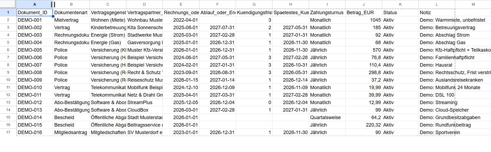
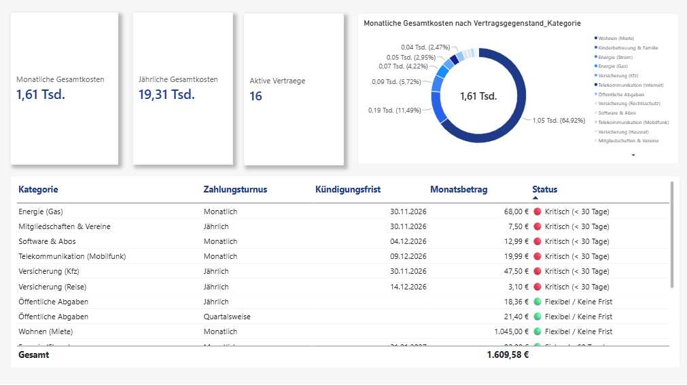

# 🛡️ Fixkosten- & Fristen-Monitor (Gemini + Power BI)

> Ein Werkzeug, das Vertragsdokumente per Gemini in ein einheitliches CSV-Schema überführt und laufende Fixkosten sowie Kündigungsfristen in einem Power-BI-Dashboard mit Fristen-Ampel überwacht.

**Hinweis:** Alle Daten in diesem Repository sind erfundene Demo-Daten (16 Beispielverträge mit fiktiven Anbietern).

---

## Rolle & Entwicklungsansatz

* **Rolle:** Christoph Bauer, Business Analyst: Problemanalyse, CSV-Schema, Gem-Anweisungen, Power-Query-Logik, DAX-Kennzahlen, Dashboard und Test.
* **Umsetzung:** M-Code und DAX habe ich mit Unterstützung von KI-Assistenten erstellt und anschließend getestet und angepasst.

---

## Ausgangslage und Lösung

* **Ausgangslage:** Vertragsunterlagen lagen in unterschiedlichen Formaten vor (PDFs, Screenshots, Bestätigungs-Mails). Es fehlte ein Überblick über die monatlichen Fixkosten, und Kündigungsfristen ließen sich leicht verpassen.
* **Lösung:** Ein Gemini-Gem liest die Dokumente aus und liefert je Vertrag eine CSV-Zeile im festen Schema. Power Query typisiert die Daten und schiebt abgelaufene Kündigungsfristen automatisch in die nächste Periode. Power BI zeigt Kosten und Fristen mit einer Ampel.
* **Ergebnis (Demo-Daten):** 16 Verträge, monatliche Fixkosten rund 1.610 €, Fristen-Ampel mit den Stufen kritisch (≤ 30 Tage), Warnung (≤ 60 Tage) und sicher.

---

## Tech Stack

* **Dokumentenanalyse:** Gemini (Gem mit eigenen Anweisungen, siehe `Gemini/`)
* **Aufbereitung:** Power Query (M), deutsches Gebietsschema für Datum und Beträge
* **Kennzahlen:** DAX (Measures und berechnete Spalten)
* **Dashboard:** Power BI Desktop

---

## Ablauf

### A. Dokumente auswerten (Gemini)
Der Gem arbeitet in zwei Modi:
* **Analyse:** Dokumenttyp, Kurzfassung, Fristen, Ablagevorschlag und ToDos. Fristen werden nur übernommen, wenn sie im Dokument stehen; nichts wird geraten.
* **Vertragsexport:** Je Vertrag eine Zeile im 12-Spalten-Schema der CSV, die Power BI direkt einliest.

Die Vertragsdaten werden dafür an Gemini übergeben. Kennzahlen und Dashboard laufen anschließend lokal in Power BI.



### B. Aufbereitung und rollierende Fristen (Power Query)
* **Typisierung:** Datums- und Betragsspalten mit Gebietsschema `de-DE`.
* **Rollierendes Kündigungsdatum:** Liegt das späteste Kündigungsdatum in der Vergangenheit, wird es je nach Zahlungsturnus (monatlich, quartalsweise, jährlich) so lange weitergeschoben, bis es in der Zukunft liegt. So bleiben auch automatisch verlängerte Verträge im Blick.

### C. Kennzahlen und Ampel (DAX)
* **Measures:** Monatliche Gesamtkosten (normiert nach Zahlungsturnus), aktive Verträge, Tage bis zur nächsten Kündigung.
* **Berechnete Spalten:** Monatsanteil je Vertrag und Fristen-Ampel auf Basis des rollierenden Kündigungsdatums.



---

## Learnings

1. **KI für unstrukturierte Eingänge, feste Regeln für Berechnungen:** Gemini übernimmt das Lesen der Dokumente; Typisierung, Fristen und Kennzahlen laufen deterministisch in Power Query und DAX.
2. **Ein festes Schema verbindet beide Welten:** Erst die genaue Spaltenvorgabe im Gem macht die Ausgabe ohne Nacharbeit für Power BI nutzbar.
3. **Fristen müssen mitlaufen:** Ein statisches Kündigungsdatum ist nach Ablauf wertlos; die rollierende Berechnung hält die Ampel aktuell.

---

## Repository-Struktur

```text
├── Data/
│   └── contracts_demo.csv               # 16 erfundene Beispielverträge
├── Dashboard/
│   └── fixkosten_fristen_monitor_demo.pbix
├── PowerQuery/
│   └── contracts_master.pq              # M-Code inkl. rollierender Kündigungsfrist
├── DAX/
│   └── measures_und_spalten.dax         # Measures und berechnete Spalten
├── Gemini/
│   └── gem_dokumenten_agent.md          # Gem-Anweisungen (Analyse + Vertragsexport)
├── Pictures/
│   ├── csv.png
│   └── dashboard.png
└── README.md
```

**Nutzung:** In Power BI unter „Daten transformieren“ → „Datenquelleneinstellungen“ den Pfad auf `Data/contracts_demo.csv` setzen und aktualisieren.
